# M4 交付检查（Linux GTK4）

- 日期：2026-11-09（UE 调整 2026-11-10）
- 基线：`e879dc8`（工作树未提交）
- 范围：Linux 原生客户端 `apps/linux`（GTK4 + libadwaita）、`fg-ffi` 服务接线，以及为停止/退出链路补上的共享进程等待修复。
- 不在本次范围：加载器安装器（M5）、Java 自动下载（M6）、账户（M7）、内容管理（M8/M9）、打包（M10）。

> 2026-11-10 UE 调整：移除标题栏左上角的播放/停止按钮，hero 主按钮在运行中切换为「停止游戏」；hero 右侧的齿轮与开始游戏按钮改为与实例图标下沿对齐；最近/收藏/全部改为强调色分段控件（选中段使用设计令牌 accent，白色文字）。

## 结论

**通过（Linux UI/UE 接线）。** 主页、实例库、下载页、安装对话框、游戏设置和
启动/停止会话都使用原生 GTK/libadwaita 控件，并复用 macOS 的 HMCL/PCL 式流程：
添加实例 → 下载页选版本 → 安装对话框选加载器/名称 → 队列 → 完成后进入游戏设置。
真实数据来自 `fg-ffi` 服务；原版 26.3 已从 Linux 客户端完成启动、窗口就绪、停止，
退出后 `play_seconds` 与 `last_played` 正确写回。

停止/退出链路在原 M4 共享层中没有等待子进程，`game.exited` 不会产生；本次为
`fg-game::GameProcess` 增加了 `wait_with_kill`，并让 `fg-ffi` 的会话 watcher 真正等待
进程退出。该修复位于共享 core，macOS 也会受益，但 macOS 的 UI 停止按钮仍建议按
M4 交付文档的交接项复验。

## 交付内容

| 模块 | 实现 |
| --- | --- |
| Core 桥 | 直接链接 `fg-ffi::Service`；3 个阻塞 RPC worker；GTK 50 ms 定时器分发回调并排空事件队列 |
| 主页 | 当前实例 hero、安装/下载/会话状态、hero 内开始/停止主按钮、标题栏实例状态项、强调色分段筛选、任务队列、Java/内存/渲染环境 |
| 实例库 | 真实实例按加载器分组、搜索、排序、预览面板、双击进入游戏设置；窄窗口列表优先 + 返回按钮 |
| 下载页 | 分类切换（宽屏分段控件/窄屏原生下拉）、版本通道、`versions.list`、版本搜索、`version.plan` 明细、安装入口、任务队列与历史 |
| 安装对话框 | 游戏版本、8 个加载器卡片（原版可用，其余 M5 预留）、加载器版本占位、实例名称、错误横幅 |
| 游戏设置 | 内存/JVM/全屏/分辨率覆盖写入（`null` 恢复继承）、Java 显示、内容里程碑、打开实例目录、删除确认 |
| 会话语义 | `launch.start` / `session.stop`、`game.started` / `windowReady` / `line` / `exited`、Toast/AlertDialog、游玩时长刷新 |
| 资源补全 | 未安装实例点开始游戏 → `install.start` → 下载页队列；完成后图书馆 + 游戏设置 |
| 导入 | XDG portal `Gtk.FileDialog` → `instances.import`，文件保留原处 |
| 响应式 | 下载页 1240 px 以下隐藏队列、折叠版本/详情分栏并把分类切换改为下拉；实例库 1180 px 以下列表优先 |

完整说明见 [`apps/linux/README.md`](../apps/linux/README.md)。

## 验收矩阵

| 检查项 | 证据 | 结果 |
| --- | --- | --- |
| 实例列表 / 主页 / 实例库真实数据 | 26.3 出现在 hero、最近列表和“原版”分组；`instances.list` 成功 | 通过 |
| 下载页版本清单与计划 | `versions.list` 从缓存清单加载；选择 26.3 后显示 Java 25、5218 个文件、610 MB、发布 2026-09-15 | 通过 |
| 安装对话框流程 | 原生 `Adw.Dialog`：版本、加载器卡片、实例名称、取消/安装；截图 `install-dialog.png` | 通过 |
| 队列 → 完成 → 游戏设置 | 调试冒烟：`install.start` 产生 `task-1`，`task.finished succeeded` 后自动进入实例库并打开 26.3 的游戏设置 | 通过 |
| 新建 → 安装 → 游戏设置 | 调试冒烟走与安装对话框相同的 `start_game_install`：创建 `M4Linux`（显示名“M4 Linux 验证”），队列验证 26.3 共享文件后成功，自动进入实例库并打开新实例的游戏设置；截图 `new-install-complete.png`，随后用 `fg-cli instance delete M4Linux` 清理 | 通过 |
| 游戏设置读取 | `instances.settings.get` 返回 effective/overrides；对话框显示内存“自动”、分辨率“跟随游戏默认”、Java“自动发现” | 通过 |
| 游戏设置写入 | `instances.settings.set` 回调已接（内存/JVM/全屏/分辨率，空值恢复继承）；自动化未逐个点击控件 | 代码路径已接 |
| 启动 / 窗口就绪 | `launch.start` 启动 26.3；收到 `game.started`（pid 59314）与 `game.windowReady` | 通过 |
| 停止 / 退出 / 时长 | 12 s 后 `session.stop`；收到 `game.exited playSeconds=10`；`instance.toml` 的 `play_seconds` 44 → 54，`last_played` 更新为 2026-11-09T05:49:39Z | 通过 |
| 停止提示 | 运行中 hero 主按钮切换为「停止游戏」（深色半透明胶囊）；点击停止后退出、原生 `Adw.Toast` 显示「游戏已停止」，主按钮恢复「开始游戏」。实测点击 hero 主按钮验证 | 通过 |
| 未安装实例补全资源 | 开始游戏在 `installed=false` 时走 `install.start`，切到下载页并提示；完成后进入设置（代码路径与 macOS 相同） | 代码路径已接 |
| 外部 `.minecraft` 导入 | 原生 FileDialog → `instances.import`；导入对话框本身未在自动化中点击 | 代码路径已接 |
| 删除实例 | 游戏设置维护区二次确认 → `instances.delete`；未在自动化中确认删除 | 代码路径已接 |
| 响应式 | 1400×880、1280×800、1000×700 三档截图；1000 px 下无 `AdwToastOverlay exceeds window width` 警告 | 通过 |
| 主题 | 深色/浅色截图；`Adw.StyleManager` 在首帧前应用，菜单与设置页同步 | 通过 |
| 原生控件 | 全部为 GTK/libadwaita 控件：`Adw.HeaderBar`、`Adw.NavigationSplitView`、`Adw.OverlaySplitView`、`Gtk.StackSwitcher`/`Gtk.DropDown`、`Adw.PreferencesPage`、`Adw.Dialog`、`Adw.AlertDialog`、`Adw.Toast`、`Gtk.FileDialog` | 通过 |

### 真实会话记录

```text
GameStarted { instance_id: "26.3", pid: Some(59314) }
GameWindowReady { instance_id: "26.3" }
stop_game: SessionState { running: true, loading: false, pid: Some(59314), ... }
GameExited { instance_id: "26.3", exit_code: None, play_seconds: 10 }
```

```toml
# instances/26.3/instance.toml
[meta]
last_played = "2026-11-09T05:49:39.742377Z"
play_seconds = 54   # 44 → 54
```

安装冒烟（复用已安装的 26.3，只验证队列与完成跳转）：

```text
event: TaskProgress { task_id: "task-1", name: "install:26.3", ... }
event: TaskFinished { task_id: "task-1", name: "install:26.3", state: "succeeded" }
→ 实例库 + 游戏设置（26.3）
```

期间发现并修复：任务结束后仍收到最后一次 `task.progress`，原逻辑把已完成行改回
`running`，导致侧栏“下载”角标永久停在 1。现在进度 tick 只更新数值，保留终态。

## 自动化检查

```text
cargo fmt --all -- --check                                  clean
cargo clippy --workspace --all-targets -- -D warnings       clean
cargo test --workspace                                      215 passed / 0 failed
cargo fmt --manifest-path apps/linux/Cargo.toml             clean
cargo clippy --manifest-path apps/linux/Cargo.toml --all-targets -- -D warnings  clean
cargo test --manifest-path apps/linux/Cargo.toml            17 passed / 0 failed
cargo build --manifest-path apps/linux/Cargo.toml --locked  success
cargo check --workspace --locked                            success
```

新增回归测试：

- `fg-game::launch::tests::wait_with_kill_terminates_a_running_process`：停止信号可在
  超时内终止进程并返回非成功退出；覆盖本次共享 core 修复。
- `models::tests::decodes_task_version_and_plan_payloads`：终态下载行收到迟到进度后
  仍保持 `succeeded`，不会复活“运行中”角标。

## 截图

| 页面 | 深色 | 窄窗口 / 其他 |
| --- | --- | --- |
| 主页 | 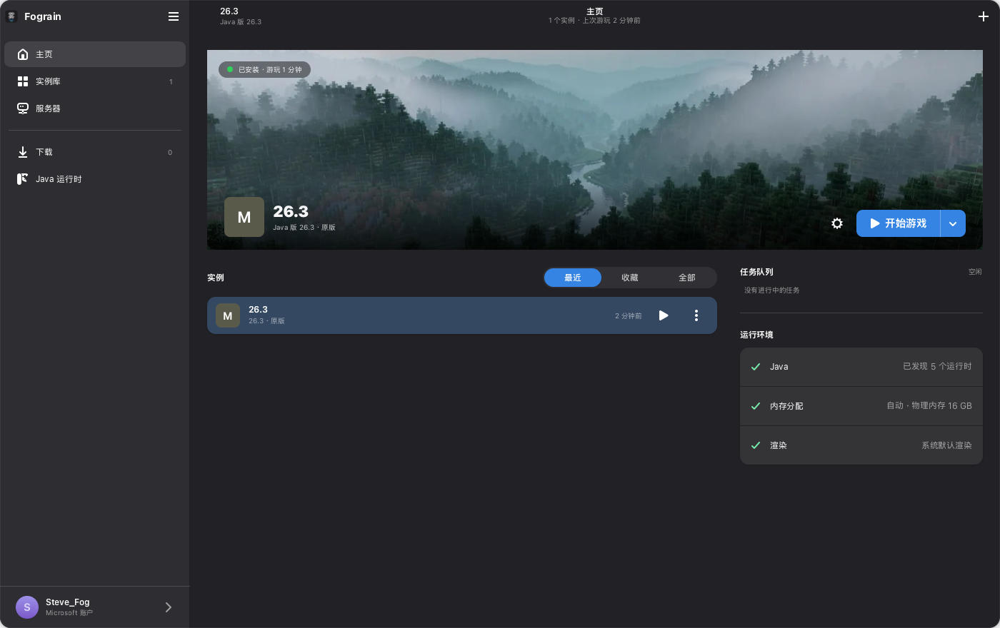 | 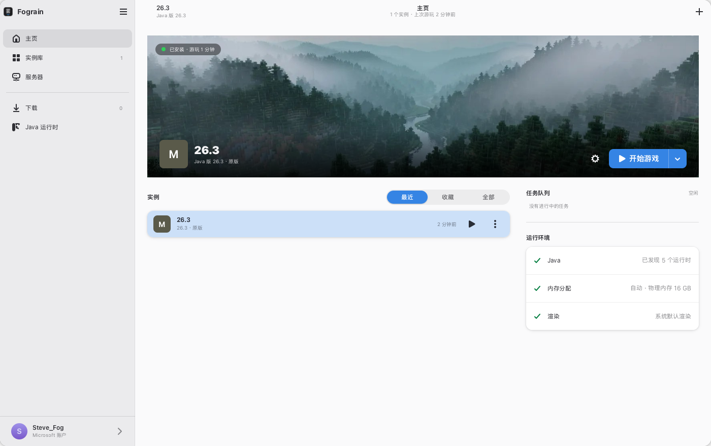 / 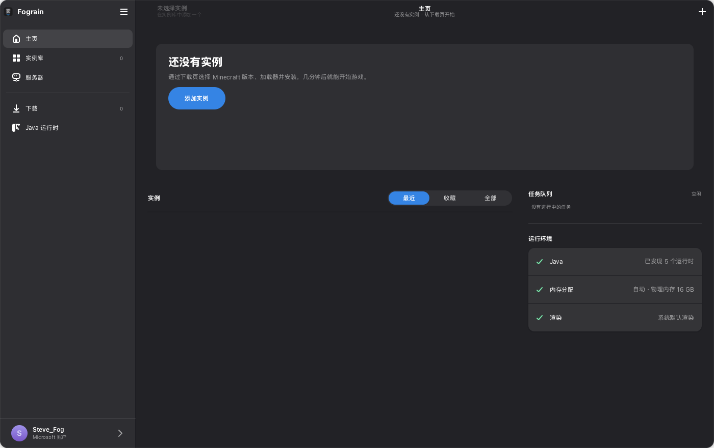 / 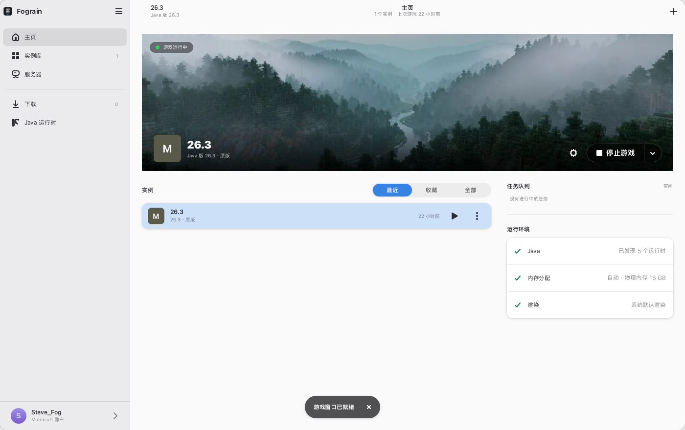 |
| 实例库 | 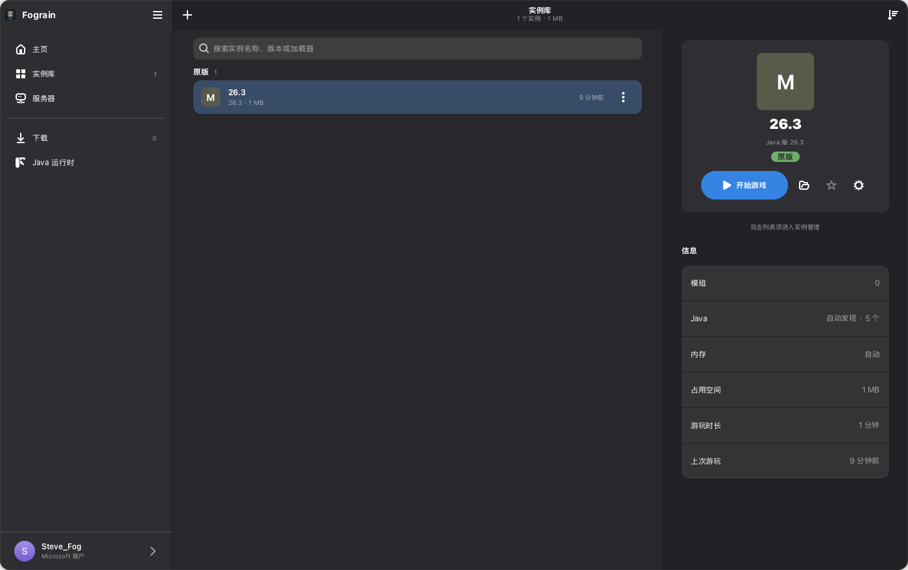 | 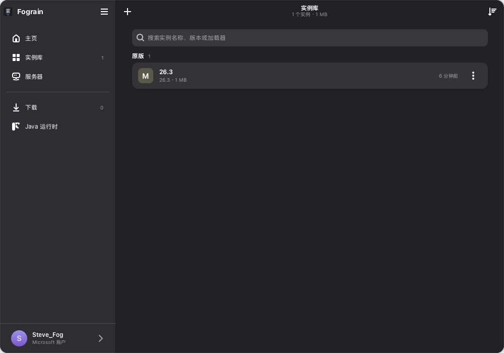 / 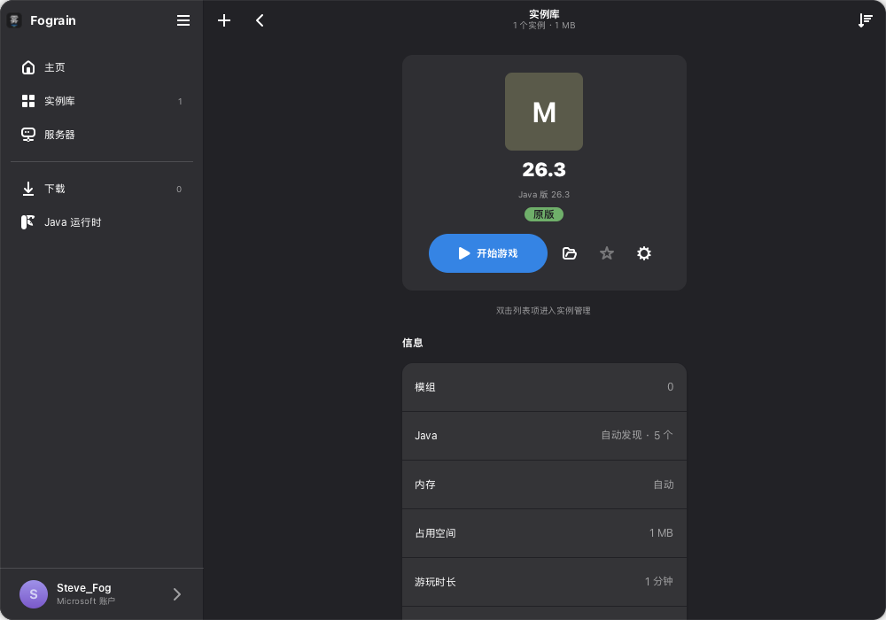 / 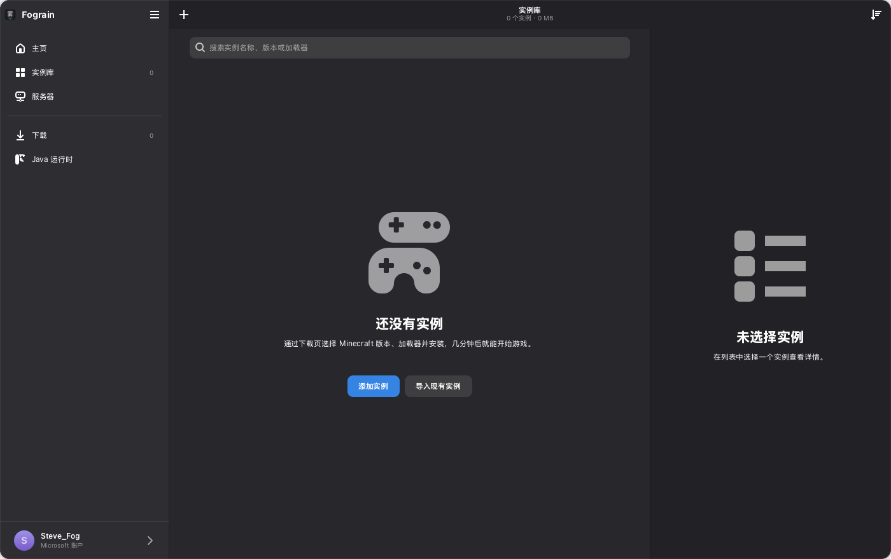 |
| 下载 | 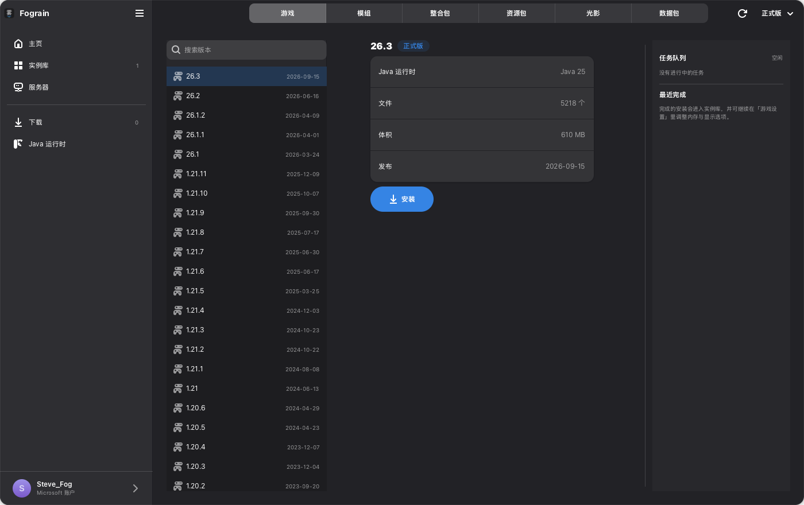 | 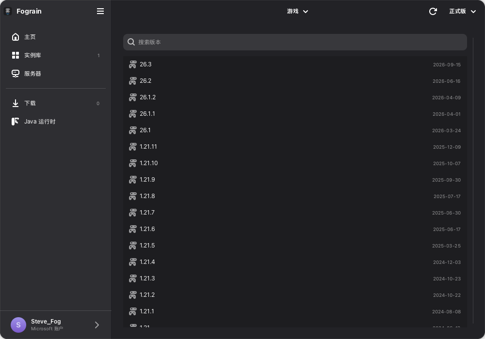 / 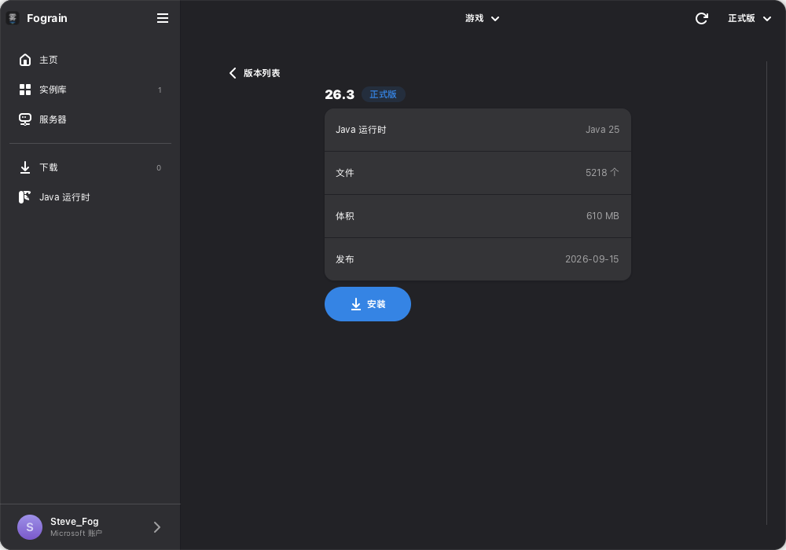 |
| 安装对话框 | 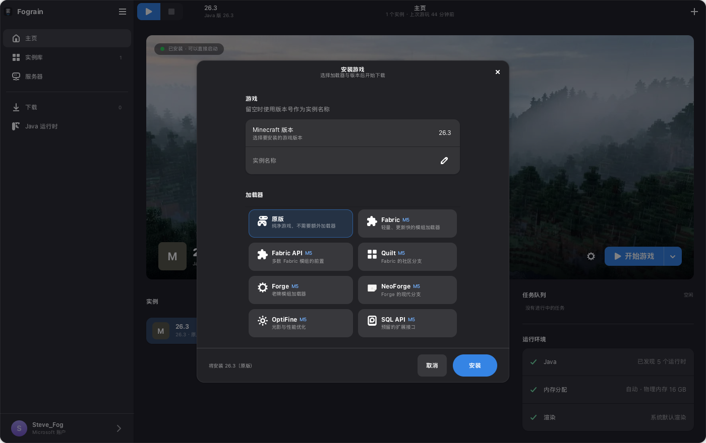 | |
| 游戏设置 | 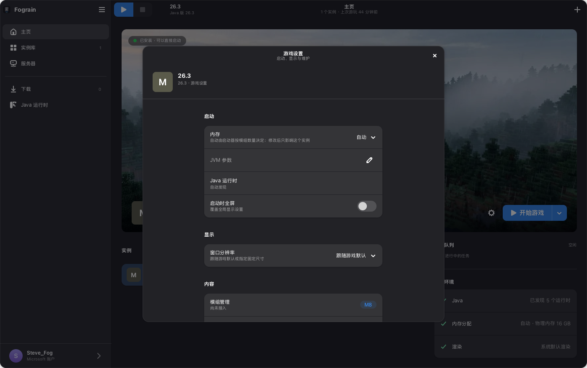 | |
| 停止提示 | 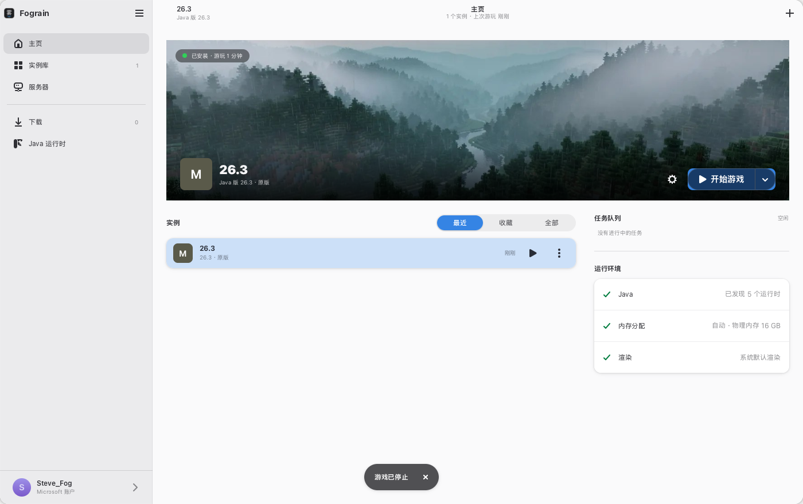 | |
| 新建安装完成 | 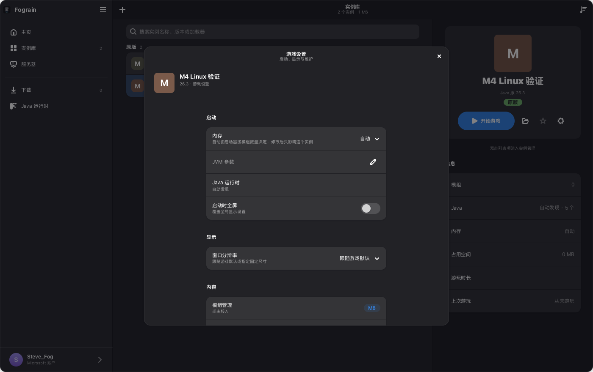 | |

## 已知限制 / 交接项

- **M5**：Forge / NeoForge / Fabric / Quilt / OptiFine 安装器未实现；安装对话框保留
  加载器卡片与占位版本，只有原版可安装。
- **M6**：Java 自动下载未实现；当前使用环境中已发现的运行时。
- **M7/M8/M9/M10**：账户、模组/资源包/光影、世界/打包、`Unity.LauncherEntry`
  任务栏进度仍按里程碑预留。
- 游戏设置的内存/JVM/全屏/分辨率写入回调、导入目录选择和删除确认已在真实 RPC 上
  接线，但本次自动化只验证了读取与安装/启动/停止；建议人工点一遍这四个控件。
- 停止通过共享 core 的 `start_kill` 终止游戏进程；退出码可能为 `None`，游玩时长
  仍会记录。更优雅的窗口关闭/SIGTERM 信号可在后续补齐。
- 共享 core 的会话等待修复改变了 `GameProcess` 的等待方式；macOS 停止按钮建议
  按 M4 交付文档原交接项复验一次。
- 本次检查没有创建 commit，保持工作树待审阅状态。
